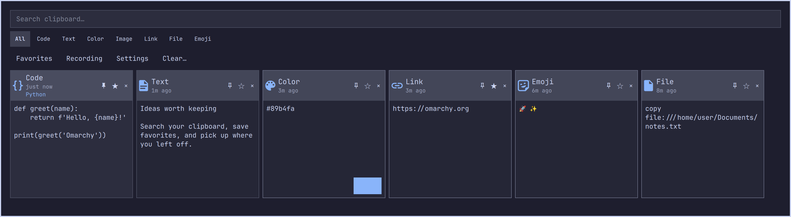

# Pano for Omarchy

A horizontal clipboard manager for Omarchy, inspired by
[Pano for GNOME](https://github.com/sterlingmchase/gnome-shell-pano).
Browse compact preview cards in a bottom-of-screen strip, search your history,
pin important clips to the front, and keep favorites—all using Omarchy's native theme and controls.



*Screenshot uses synthetic data. Optional type buttons and language labels are
shown enabled; they default to off.*

- Text, code, colors, links, images, emoji and supported file references.
- Horizontal scrolling, keyboard selection and a narrow-screen list layout.
- Persistent history, deduplication, front-pinned cards, favorites and configurable retention.
- Optional color palette, language labels and type-filter buttons.
- Incognito, session-only history and optional background link-title previews.

**Tested platform:** Omarchy 4.0.4-1, Quickshell 0.3.1, wl-clipboard 2.3.0,
and Pygments 2.21. This is an Omarchy shell plugin, not a GNOME extension or a
standalone app. It uses Python 3 for short-lived clipboard/file operations;
Pygments is optional for less common code languages. No new daemon or database.

**Status:** early version. Native display, opening/closing, focus restoration
and a single active clipboard watcher have been checked. Automated tests cover
storage and UI layout; the remaining native integration checks are listed below.
Read the format limitations before relying on file-cut operations.

## Interface

Compact cards show type, relative copy time, preview, pin, favorite, and delete.
Wide displays use a shallow, nearly full-width horizontal card strip at the bottom
of the screen, inspired by the Pano reference. Narrow displays use a vertical list.
Scroll the strip with a mouse wheel, a horizontal or vertical touchpad gesture,
or drag. Touchpad scrolling has a 1.7× sensitivity boost and a short,
speed-dependent glide after release (capped at roughly 0.46 seconds). New scrolling,
keyboard selection, search/filter changes, Settings, dragging or closing stop the
glide. Existing system momentum is respected without adding another glide;
ordinary mouse-wheel steps remain direct.
Left/Right select cards while search is empty; Up/Down also select cards.
Disable horizontal cards in Settings to use the vertical list everywhere.
Images are decoded asynchronously at a capped thumbnail size. Text is always
plain text, including HTML/code. File cards show the operation and decoded URIs;
they never open files or walk remote mounts for previews.

Search combines with the type filter and Favorites. The selected type remains
active if its optional buttons are hidden; Ctrl+1 resets it to All. Up/Down
select entries; Enter in search copies the selection. Tab reaches cards,
swatches, filters, settings, and actions. Enter/Space activates a focused button
or card. Settings opens as a centered page with its own heading and Back button;
search, the color palette, filters and history actions are hidden there. Back or
Escape returns to the history view and restores search focus. Clicking outside closes.
Closing unmaps the layer surface to release keyboard focus to the compositor.

| Shortcut | Action |
| --- | --- |
| Ctrl+F | Focus search |
| Ctrl+1…8 | All, Code, Text, Color, Image, Link, File, Emoji |
| Ctrl+B | Toggle Favorites filter |
| Ctrl+D | Favorite/unfavorite selected entry |
| Ctrl+P | Pin/unpin selected entry at the front |
| Ctrl+S | Open/close Settings |
| Delete (outside search) | Delete selected entry |
| Ctrl+Delete | Confirm clearing all saved and session history, including pinned cards and favorites |

The clear dialog opens on **Cancel** and traps keyboard confirmation.
Selecting normally copies only. Optional automatic paste closes the overlay,
waits for focus release, then uses the installed `wtype` Shift+Insert mechanism,
as the native Omarchy clipboard helpers do. This is not universally accepted by
all applications; keep it off when exact focus/paste behavior matters.

## Pin cards to the front

Click the pin icon in a card header, or select a card and press **Ctrl+P**.
The pin is outlined when unpinned and filled/accented when pinned. Card actions change icon color on hover without
background boxes; an underline marks keyboard focus. Pinned cards stay before ordinary history,
even when new items arrive or an existing item is copied again. If you pin
several cards, the most recently pinned appears first. Unpinning restores the
card's normal position by copy time.

Pinning is separate from the star/Favorites filter. Pins still respect search,
type filters and the Favorites filter, and they do not count toward the ordinary
retention limit. Pins persist with saved history; session-only pins follow the
same temporary lifetime as other session entries. You can explicitly delete a
pinned card. Clear-history also removes pins and says so in its confirmation.

## Settings and privacy

All settings take effect live and are stored in
`${XDG_STATE_HOME:-~/.local/state}/omarchy-pano/settings.json`.
The settings file is watched, so external edits also take effect. Its keys are:

| Key | Default | Behavior |
| --- | --- | --- |
| `colors` | false | Up to ten recent colors derived from current history; copies original text and stays open |
| `languages` | false | Small language labels on code cards; detection remains available for the Code filter |
| `filters` | false | Wrapping type **buttons** below search; no dropdown |
| `retention` | 300 | Ordinary entries to keep, clamped to 0–5000; favorites and pins do not count |
| `previews` | false | Download titles for selected links in the background |
| `incognito` | false | Stop the watcher and reject in-flight captures at storage time |
| `sessionOnly` | false | Use private runtime history instead of persistent history |
| `paste` | false | Automatically paste after selection; color-palette clicks still copy only |
| `horizontal` | true | Horizontal cards when enough screen width is available |

Session-only history starts empty. Switching modes clears the temporary history;
it **does not migrate or erase previously saved history**. Turning session mode
off reveals that saved history again. Clear-history explicitly clears **both**
stores. Temporary payloads are removed on orderly unload/reload. After a hard
crash they may remain under `$XDG_RUNTIME_DIR` until logout; they are not reloaded
by a new plugin instance. A valid XDG runtime directory is recommended; the
fallback `/tmp` is not guaranteed to be memory-backed or cleaned at logout.

Private state directories use mode 0700; payload/history/settings files use 0600.
These are ordinary unencrypted files, subject to backups and filesystem recovery.
Deletion unlinks payloads; it is not secure media erasure. Link titles exist only
in memory, are dropped on deletion/clear, and are never saved as preview files.
Clipboard values and subprocess output are never intentionally logged. The
plugin does not inspect the active app or implement unreliable app exclusions.
Only standard clipboard selection is recorded, not primary selection.

The watcher respects `CLIPBOARD_STATE=sensitive` and
`x-kde-passwordManagerHint`. Unmarked secrets cannot be identified reliably;
use Incognito. The installed wl-clipboard itself derives its sensitive flag
from the KDE MIME hint. No independent clipboard capture runs alongside the
built-in plugin: recording is refused until `omarchy.clipboard` is disabled,
and a private file lock prevents two Pano watcher instances.

## Formats and performance limits

Payloads preserve exact selected-MIME bytes, including whitespace, trailing
newlines, invalid UTF-8, image bytes and GNOME file `copy`/`cut` records.
Preview decoding never modifies the stored payload. Deduplication uses MIME plus
a SHA-256 of those bytes; repeating a favorite moves it newest and retains its
favorite flag. Recopying a pinned card also preserves its pin position. Different
MIME representations remain distinct entries.

Supported formats: plain text/UTF8_STRING/STRING, PNG/JPEG/WebP/GIF/BMP/TIFF,
`text/uri-list` containing local file references, and
`x-special/gnome-copied-files`. Text is classified as link, color, emoji, code,
or ordinary text. Other offered formats are skipped rather than converted.
Malformed GNOME file operations are rejected. Invalid image data can be retained
but shows a preview-unavailable message. UTF-16 and non-UTF8 text remain exact
on copy; readable preview decoding is UTF-8 with replacement characters.

**Platform gap:** wl-clipboard 2.3.0 cannot offer multiple MIME types at once
(its installed man page, BUGS). Thus this plugin cannot reproduce full multi-MIME
clipboard offers, rich-text alternatives, or KDE file-cut semantics that require
`application/x-kde-cutselection` together with file URLs. Offers with that KDE
cut marker are deliberately skipped. GNOME cut/copy records are replayed as
original records, but the receiving app must support that format. Local file
references with remote `file://host/...` authorities are rejected.

One native `wl-paste --watch` triggers bounded snapshots. This installed version
does not export `CLIPBOARD_TYPE`, so the helper explicitly requests the preferred
supported MIME (GNOME operation, file URI, image, then plain text). It checks the
offer before/after and compares the plain-text trigger to reject stale snapshots.
**Rapid changes between independent Wayland requests can still lose an entry**,
particularly binary offers without a plain-text guard; wl-clipboard provides no
selection identity token for an atomic multi-request snapshot. Guaranteed
atomic multi-format capture/replay requires a different native clipboard API.

Payloads larger than 32 MiB are skipped. Reads have timeouts; capture children
have an eight-second outer deadline. Only the first 8192 decoded characters are
searched/classified/rendered, and language analysis is capped to that prefix.
Search does not match text beyond it. Metadata is loaded for the retained
history; ListView constructs only visible cards and thumbnails. Very large
favorite or pinned collections increase metadata memory usage because protected
entries are never automatically trimmed.

Colors support CSS hex RGB/RGBA, rgb()/rgba(), hsl()/hsla(), and `transparent`.
Named CSS colors and newer CSS color spaces are not currently detected.
RGBA channels are passed through `Qt.rgba`, preserving CSS alpha ordering rather
than interpreting CSS #RRGGBBAA as Qt #AARRGGBB. Checkerboard backdrops show alpha.
Short code detection is deliberately conservative: HTML/XML, PHP, CSS, JS, TS,
Python, SQL and shebang shell scripts have structural checks; other structurally
code-like snippets use installed Pygments. Uncertain structural code gets Code;
ambiguous snippets may remain Text. Older entries without language metadata are
backfilled from a bounded payload prefix.

Link cards appear immediately. Only the selected link may request a title;
there is no eager download for every card, favicon, image, redirect or cookie
jar. HTTP(S) requests validate global IP destinations and pin the checked
address while preserving the TLS hostname. Responses cap at 128 KiB, socket
operations time out after two seconds, and QML terminates a request after four
seconds, including slow DNS. A slow/failed request leaves the basic link card.
Cancellation generations and stable IDs ignore late responses after clear,
close, deletion, or disabled previews. No redirects are followed.

## Install

Keep the built-in clipboard history intact for rollback. Pano uses its own
state; it does not import or rewrite Omarchy's existing history.

1. Review the source and verify the tested Omarchy/Quickshell versions above.
   Required tools are `python3`, `wl-paste`, `wl-copy`, `flock`, `setpriv` and
   `timeout`; automatic paste also needs `wtype`. The reference Omarchy system
   already provides these. Do not upgrade your desktop solely to try this plugin.
2. Install without enabling it yet:

   ```sh
   omarchy plugin add https://github.com/sterlingmchase/omarchy-pano.git --yes
   ```

   Alternatively, copy this checkout to
   `~/.config/omarchy/plugins/sterling.pano/` and run
   `omarchy-shell shell rescanPlugins`. Do not use symlinks: the validator rejects them.
3. Disable the built-in watcher **before** enabling Pano:

   ```sh
   omarchy plugin disable omarchy.clipboard
   omarchy plugin enable sterling.pano
   ```

4. Add the invocation shortcut using this installed Omarchy's Lua bindings
   mechanism in `~/.config/hypr/bindings.lua`. Choose a free shortcut, or
   explicitly unbind the native one before reusing it. For example, the
   installed default clipboard binding is Super+Ctrl+V:

   ```lua
   hl.unbind("SUPER + CTRL + V")
   o.bind("SUPER + CTRL + V", "Pano clipboard", "omarchy-shell shell toggle sterling.pano")
   ```

   Use the existing file's `hl`/`o` setup. If it does not use those locals,
   follow `/usr/share/omarchy/default/hypr/bindings/clipboard.lua` and the local
   binding conventions rather than pasting an incompatible API. Validate with
   `hyprctl reload` and `hyprctl configerrors` after editing the binding.
   The plugin intentionally does not rewrite desktop shortcuts.

5. Open with **Super+Ctrl+V**, or `omarchy-shell shell toggle sterling.pano`.
   Settings are available from the Settings button or Ctrl+S.

For updates, use `omarchy plugin update sterling.pano`. If an updated layout
still looks unchanged after reload, close the overlay and run
`omarchy restart shell` to release Quickshell's cached components. This briefly
restarts the shell's bar and widgets.

## Rollback

Disable `sterling.pano`, enable `omarchy.clipboard`, and restore your
previous binding. Do not delete either history directory unless you intend to
erase it. Remove the Pano plugin directory only after disabling it. Normal
plugin disable/unload stops managed processes; session files are cleaned on
orderly teardown. No installed Omarchy or GNOME extension files are modified.

## Validation

Run from this directory:

```sh
omarchy plugin validate .
python -m unittest discover -s tests -v
node tests/model.test.js
python tests/ui_smoke.py
/usr/lib/qt6/bin/qmlformat Pano.qml >/dev/null
```

- **Native validator:** the installed Omarchy manifest validator checks schema,
  ID, entry point, and absence of symlinks. QML parser checks syntax.
- **Storage/classification tests:** synthetic bytes test exact payloads,
  ordering, pin persistence, favorites, retention, clearing both stores, malformed history,
  settings, session teardown, concurrent operations, bounded reads and hints.
  Clipboard copying, snapshots, and network responses are **mocked**, never
  the user's clipboard or public internet.
- **UI layout tests:** actual installed Omarchy controls and model run under
  Quickshell in a temporary tree. The Wayland PanelWindow is replaced with an
  offscreen Qt Window; all desktop I/O is disabled. Explicit layout polishing
  exercises 16 wide/narrow optional-setting combinations, momentum initiation,
  reversal/cancellation, system-momentum handling, mouse-wheel behavior, combined filters,
  settings, confirmation and close recursion. This is a **mocked host** test,
  not native compositor testing or screenshot-based visual QA. Expected socket
  warnings reflect sandbox restrictions. The harness copies installed UI
  modules into a temporary directory; it does not edit them.

### Remaining native checks

Use synthetic text, code, emoji, links, supported color notations and alpha,
local file copy/cut offers, and small known image fixtures. Verify copied bytes
with `wl-paste --no-newline --type <mime>` and a checksum; verify file operation
semantics in a compatible file manager. Check each supported image MIME and
malformed/unsupported offers. Test dedup/favorite ordering, retention=0 and a
small positive limit, delete, and clear with Cancel/Confirm.

Check mouse selection, Tab/Shift+Tab, search editing, arrow selection, Enter,
Escape, all Ctrl shortcuts, dialog focus trapping, and focus restoration to
different application types. Test optional automatic paste separately.

Check all three optional settings individually and together, ten swatches,
transparent swatches, and original text copying without closing. Try a narrow
monitor, large font/scaling, multiple monitors and focused-monitor invocation,
live theme changes, horizontal/vertical layouts and long previews. Native
accessibility/screen-reader behavior and hover/focus rendering need visual QA.

Check `wl-copy --sensitive` rejection, Incognito, session mode toggles, orderly
unload/reload, watcher count (only one Pano wl-paste), abrupt shell termination,
slow/failing preview requests, deletion/clear/closing during downloads, disk
permission failures, and restoration of the original clipboard plugin.

## Sources and attribution

Inspired by the layout and feature set of
[Pano for GNOME](https://github.com/sterlingmchase/gnome-shell-pano) and its
[reference screenshot](https://extensions.gnome.org/extension-data/screenshots/screenshot_5278_t6BUZyl.png).
No GNOME/GJS extension code or reference artwork is bundled.
Native API and appearance compatibility were checked against the installed
Omarchy shell's clipboard plugin, PluginShellApi, Button, Toggle, TextField,
ConfirmDialog, Color and Style components. Those runtime components retain
their upstream licenses.

This plugin's original source is [MIT licensed](LICENSE).
wl-clipboard behavior was checked against its installed manual and
[upstream wl-paste source](https://github.com/bugaevc/wl-clipboard/blob/master/src/wl-paste.c).
